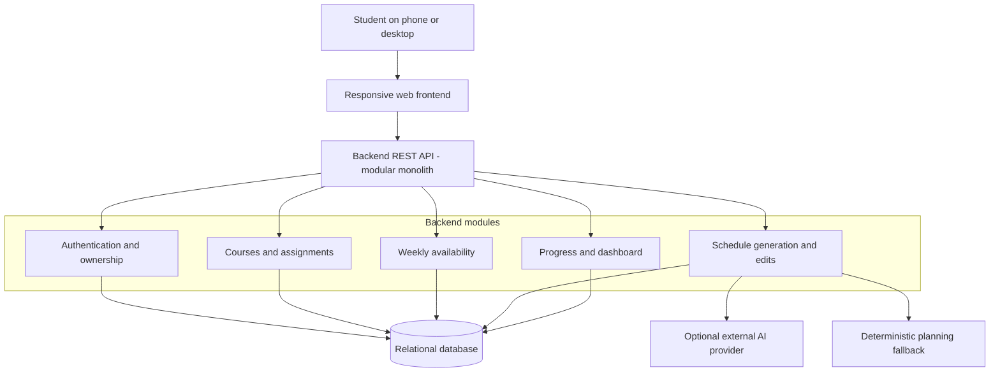

# StudyFlow AI — High-Level Architecture Plan

## Goals and Scope

Build a mobile-friendly MVP that lets students enter courses, assignments, and availability, then generate, adjust, and complete study sessions. Prioritize demo reliability, understandable code, student ownership of data, and predictable behavior if the AI provider is unavailable.

## Architecture Decision: Modular Monolith

Use **one backend application** organized into feature modules rather than separately deployed microservices. One relational database stores the source of truth. An external AI provider is optional; a deterministic planning algorithm guarantees a working demonstration.

**Reasoning:** A hackathon team can implement, test, and deploy a single service faster. Separate modules preserve the option to extract planning later if traffic or team size justifies it.

## System Diagram

## Component Responsibilities

| Component | Responsibility |
|---|---|
| Responsive frontend | Forms, upcoming deadlines, calendar/session list, editing and completion actions; responsive at phone width |
| REST backend | Validate requests, authorize ownership, expose resources, coordinate feature modules |
| Authentication module | Account sign-in, password hashing, session/token validation |
| Courses and assignments module | CRUD operations, deadlines, estimated workload, assignment status |
| Availability module | Validate and store recurring weekly study windows |
| Planning module | Allocate work before deadlines, avoid overlaps, save sessions, respect manual edits |
| Progress module | Aggregate outstanding assignments and completed study sessions |
| Relational database | Persist User, Course, Assignment, AvailabilityWindow, StudyPlan, StudySession |
| Optional AI provider | Suggest ordering or distribution of tasks; cannot bypass server-side validation |

## Typical Request Flow

1. Student signs in; the backend establishes the user identity.
2. Student adds a course and assignment; the API validates and saves both.
3. Student defines weekly availability windows and requests a plan.
4. Planning reads pending assignments and free time, tries optional AI-assisted suggestions, then validates them. If AI fails or returns unusable suggestions, it uses the deterministic fallback.
5. Valid non-overlapping sessions are saved as a plan; unscheduled workload is reported explicitly.
6. Student manually adjusts sessions and marks sessions complete; the backend saves changes and the dashboard refreshes.

## Proposed API Surface

| Method | Route | Purpose |
|---|---|---|
| POST | `/api/auth/login` | Sign in |
| GET/POST | `/api/courses` | List and add courses |
| PATCH/DELETE | `/api/courses/{id}` | Edit or delete a course |
| GET/POST | `/api/assignments` | List and add assignments |
| PATCH/DELETE | `/api/assignments/{id}` | Update or delete assignments |
| GET/POST | `/api/availability` | Read or add free-time windows |
| DELETE | `/api/availability/{id}` | Remove a window |
| POST | `/api/plans/generate` | Generate a weekly plan |
| GET | `/api/plans/current` | Read active plan |
| PATCH | `/api/sessions/{id}` | Reschedule or mark session complete |
| GET | `/api/dashboard` | Upcoming work and progress |

All routes except login require authentication; enforce user ownership at the database-query or service layer.

## Scheduling Constraints

- Prioritize earlier deadlines; divide required effort into manageable sessions.
- Place sessions only within availability windows, before due dates, without overlaps.
- Report remaining unscheduled minutes when available time is insufficient.
- Validate any AI-generated output against the same constraints as the fallback.
- Do not silently overwrite sessions the student has manually changed.

## Quality, Security, and Testing

- **Validation:** Reject blank names, invalid dates, negative effort, invalid availability windows, and conflicting edits.
- **Security:** Use hashed passwords, HTTPS, protected endpoints, ownership checks, and server-held AI keys; do not put private student content in logs.
- **Privacy:** Send minimal, preferably de-identified task information to external AI services.
- **Reliability:** AI timeout and structured-output validation; deterministic fallback when AI is unavailable.
- **Tests:** Unit tests for scheduling and validation; API tests for authorization and CRUD; end-to-end demo covering course -> assignment -> availability -> plan -> reschedule -> completion.
- **Responsive design:** Verify no horizontal overflow at ~375px and usable forms on touch screens.

## Implementation Sequence

1. Database schema and authentication; basic course/assignment APIs.
2. Availability editor and deterministic scheduling algorithm.
3. Session editing, completion tracking, dashboard.
4. Optional AI refinement with validation and fallback.
5. End-to-end tests, phone-width review, error states, hackathon demo.

## Explicit Non-Goals

No payment processing, university integrations, social features, native mobile apps, or push notifications in the MVP. Keep these as future iterations, not hidden dependencies of the demonstration.
