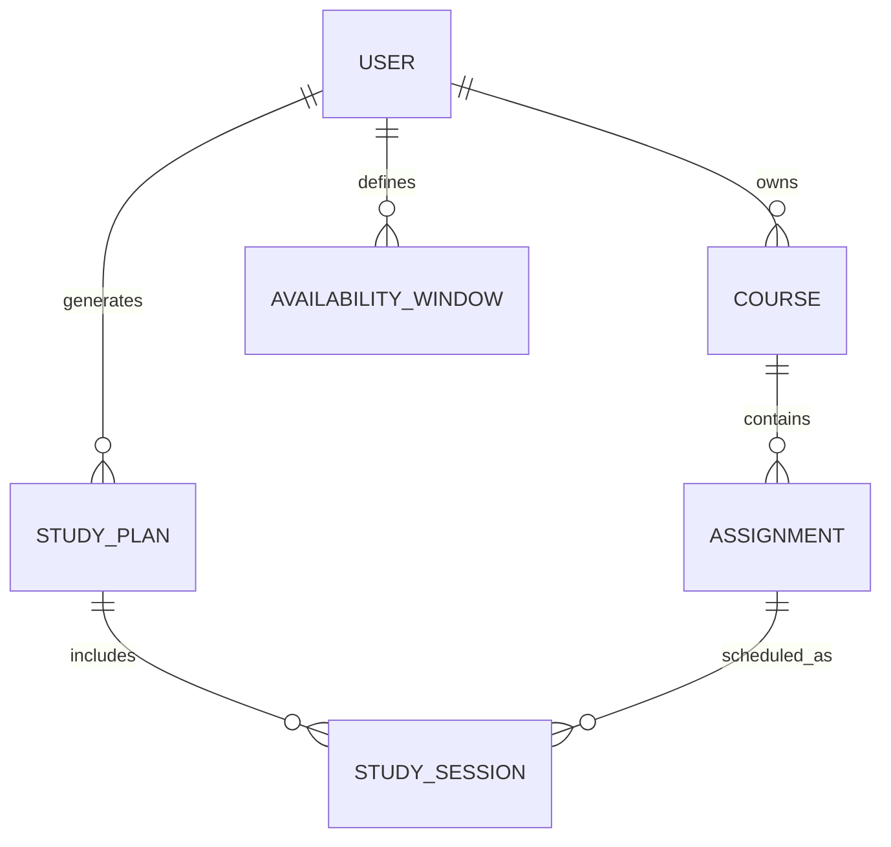

# StudyFlow AI — MVP Data Model

## Overview

A relational data model keeps each student's courses, assignments, weekly free time, and planned study sessions together. The MVP uses six entities, with a deliberate separation between **assignments** (what must be done) and **study sessions** (when work is planned).

## Entities and Fields

### 1. User
| Field | Type | Rules |
|---|---|---|
| id | UUID | Primary key |
| email | VARCHAR(255) | Required, unique |
| password_hash | TEXT | Required; never store plain-text passwords |
| created_at | TIMESTAMP | Required, server-generated |

### 2. Course
| Field | Type | Rules |
|---|---|---|
| id | UUID | Primary key |
| user_id | UUID | Required, foreign key -> User.id |
| name | VARCHAR(120) | Required, not blank |
| created_at | TIMESTAMP | Required |

### 3. Assignment
| Field | Type | Rules |
|---|---|---|
| id | UUID | Primary key |
| course_id | UUID | Required, foreign key -> Course.id |
| title | VARCHAR(200) | Required, not blank |
| due_at | TIMESTAMP | Required, time-zone-aware |
| estimated_minutes | INTEGER | Required, > 0 |
| status | ENUM | `pending` or `completed`; default `pending` |

### 4. AvailabilityWindow
| Field | Type | Rules |
|---|---|---|
| id | UUID | Primary key |
| user_id | UUID | Required, foreign key -> User.id |
| weekday | INTEGER | 0=Monday ... 6=Sunday |
| start_time | TIME | Required |
| end_time | TIME | Required, later than start_time |

### 5. StudyPlan
| Field | Type | Rules |
|---|---|---|
| id | UUID | Primary key |
| user_id | UUID | Required, foreign key -> User.id |
| week_start | DATE | Required; Monday of plan week |
| generation_method | ENUM | `ai`, `fallback`, or `manual` |
| created_at | TIMESTAMP | Required |

### 6. StudySession
| Field | Type | Rules |
|---|---|---|
| id | UUID | Primary key |
| plan_id | UUID | Required, foreign key -> StudyPlan.id |
| assignment_id | UUID | Required, foreign key -> Assignment.id |
| start_at | TIMESTAMP | Required |
| end_at | TIMESTAMP | Required, later than start_at |
| status | ENUM | `pending` or `completed` |
| manually_edited | BOOLEAN | Default false; preserve explicit edits |

## Entity Relationship Diagram

## Relationships and Rules

1. One **User** owns many **Courses**, **AvailabilityWindows**, and **StudyPlans**.
2. One **Course** has many **Assignments**; ownership is inherited from the course's user.
3. One **StudyPlan** contains many **StudySessions**.
4. One **Assignment** may be split across multiple **StudySessions**.
5. A session's `assignment_id` must resolve to an assignment owned by the same user as the plan; enforce in application service logic (or database triggers).
6. Sessions for the same student must not overlap, must fit valid availability, and must finish before the related due date. The planner checks this; server-side validation also applies to manual edits.
7. Store timestamps in UTC and convert to the student's selected local time zone in the interface. For the MVP, the time zone can be stored in user preferences or supplied as a validated setting.
8. Delete dependent records in a predictable way: deleting a course requires confirmation and removes or archives its assignments and associated sessions in a transaction.

## Example Workflow

A student creates **Algorithms** (Course), adds **Graph Homework** (Assignment: 120 minutes, Friday deadline), records Monday and Tuesday evening free slots (AvailabilityWindow), and generates a weekly StudyPlan. The plan contains two 60-minute StudySessions for that assignment; the student can move one session or mark it completed.

## Explicit MVP Boundaries

- No payments, institutional synchronization, group collaboration, or notification delivery system.
- AI responses are suggestions and must pass the same scheduling validation as fallback-generated plans.
- Exact database product can be SQLite during the demo, with a migration path to PostgreSQL as usage grows.
