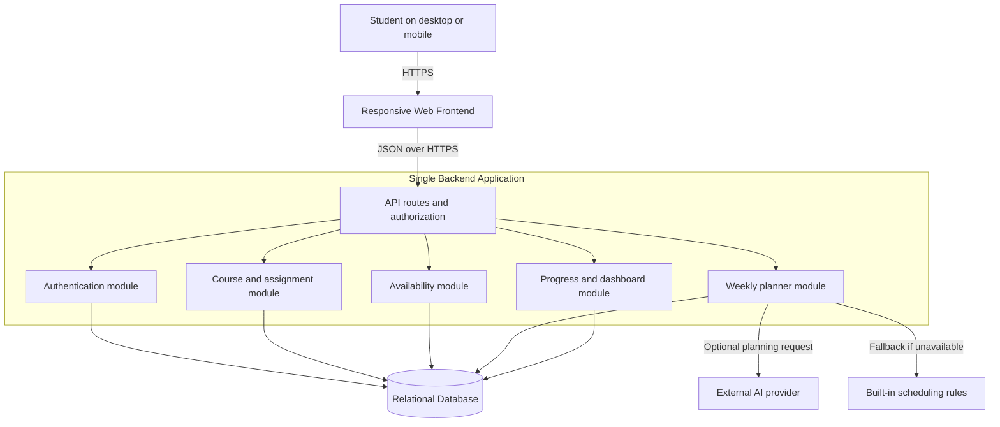

# StudyFlow AI — High-Level MVP Architecture

## Architecture choice
Use a **modular monolith** for the MVP: one responsive web frontend, one deployable backend organized into clear modules, and one relational database. The planner can optionally call an external AI provider, with a local rules-based fallback. This minimizes cost and deployment complexity while keeping the system maintainable.

## System diagram

## Responsibilities
| Component | Responsibility |
| --- | --- |
| Web frontend | Forms for courses, assignments, weekly availability; deadline dashboard; editable schedule; progress summary; mobile-friendly layout. |
| API / authorization | Validates input, checks the signed-in student owns each requested record, and returns consistent errors. |
| Authentication | Registration, secure password hashing, login/logout, and session handling. |
| Course and assignment module | CRUD for courses/assignments, validation of due dates and estimated study durations. |
| Availability module | Stores day-of-week time windows and rejects invalid or overlapping windows. |
| Planner module | Produces nonoverlapping weekly sessions using open assignments and availability, prioritizing near deadlines. |
| Progress and dashboard module | Shows upcoming/overdue work and calculates completion from stored session statuses. |
| Relational database | Persists users, courses, assignments, availability windows, and study sessions. |
| AI provider / fallback | AI can suggest plans but is not trusted for data authorization or validation; deterministic rules are available on failures. |

## Main request flows
1. **Add assignment:** Student submits form → API authenticates user and validates fields → assignment module saves a user-owned record → frontend refreshes deadline dashboard.
2. **Generate plan:** Student requests a week → planner retrieves that student's open assignments and availability → creates a valid proposal (AI-assisted if configured, rules-based otherwise) → validates that session times are nonoverlapping and inside available windows → saves proposed sessions → frontend displays an editable schedule.
3. **Record progress:** Student completes a session → API checks ownership and updates status → progress module recalculates that week's completion summary.

## Security, reliability, and constraints
- All private routes require authentication; ownership is enforced on the server, not just by hiding UI elements.
- Use HTTPS; store password hashes (not passwords), keep AI provider keys server-side, and minimize transmitted personal data.
- Validate assignments, times, and session overlaps on the backend. Treat AI output as untrusted proposals and validate it before saving.
- Keep manual schedule edits persistent; plan regeneration must not overwrite them without an explicit user action.
- Start with low-cost hosting and database tiers. Add AI API rate limits, a spending cap, and a rules-based fallback.
- No payment flow, university system sync, push notifications, or native mobile application in MVP scope.

## Future evolution
If usage grows, planner processing can be moved into a background job or separate service. This is not necessary to launch the first version.
