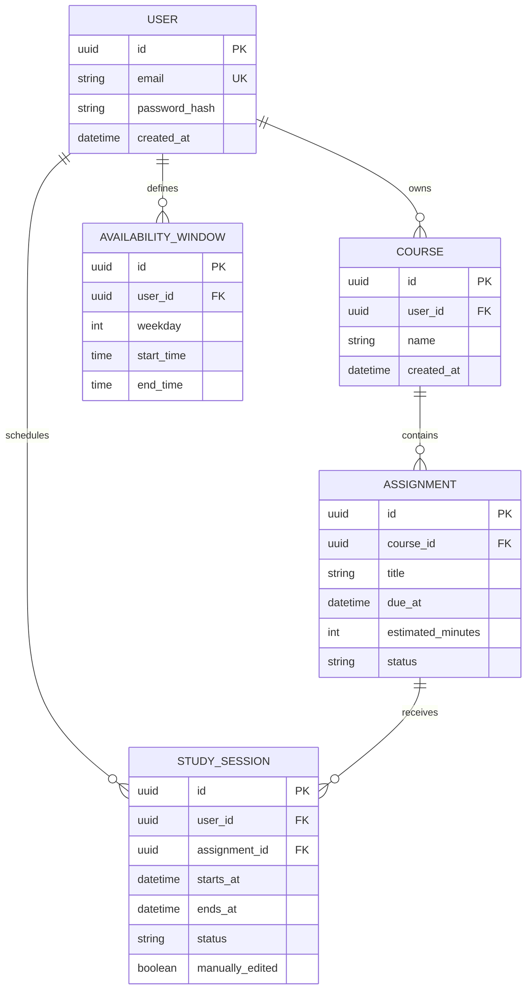

# StudyFlow AI — MVP Data Model

## Overview
A relational database stores the minimum information required for the MVP. Five entities are sufficient: **User**, **Course**, **Assignment**, **AvailabilityWindow**, and **StudySession**. Each course belongs to one student; each assignment belongs to one course; and a student's planned study sessions refer to their assignments.

## Entity relationship diagram

## Field definitions

### User
| Field | Type | Rules |
| --- | --- | --- |
| `id` | UUID | Primary key. |
| `email` | string | Required, unique, normalized for login. |
| `password_hash` | string | Required; a secure salted password hash, never plaintext. |
| `created_at` | timestamp | Required; stored in UTC. |

### Course
| Field | Type | Rules |
| --- | --- | --- |
| `id` | UUID | Primary key. |
| `user_id` | UUID | Required foreign key → User.id. |
| `name` | string | Required, nonblank. |
| `created_at` | timestamp | Required; UTC. |

### Assignment
| Field | Type | Rules |
| --- | --- | --- |
| `id` | UUID | Primary key. |
| `course_id` | UUID | Required foreign key → Course.id. |
| `title` | string | Required, nonblank. |
| `due_at` | timestamp | Required; UTC. |
| `estimated_minutes` | integer | Required; > 0. |
| `status` | enum | `open` or `completed`; default `open`. |

### AvailabilityWindow
| Field | Type | Rules |
| --- | --- | --- |
| `id` | UUID | Primary key. |
| `user_id` | UUID | Required foreign key → User.id. |
| `weekday` | integer | Required; 1 (Monday) through 7 (Sunday). |
| `start_time` | time | Required; local wall-clock time. |
| `end_time` | time | Required and later than start_time; same day. |

### StudySession
| Field | Type | Rules |
| --- | --- | --- |
| `id` | UUID | Primary key. |
| `user_id` | UUID | Required foreign key → User.id. |
| `assignment_id` | UUID | Required foreign key → Assignment.id. |
| `starts_at` | timestamp | Required; UTC. |
| `ends_at` | timestamp | Required, after starts_at. |
| `status` | enum | `planned` or `completed`; default `planned`. |
| `manually_edited` | boolean | Default false; preserve user edits during replanning. |

## Relationship and integrity rules
1. One **User** owns zero or more **Courses**, **AvailabilityWindows**, and **StudySessions**.
2. One **Course** contains zero or more **Assignments**. The assignment's owner is derived from its course's `user_id`.
3. One **Assignment** may be linked to multiple **StudySessions**.
4. The backend must verify `StudySession.user_id` matches the owner of the referenced assignment's course; an assignment from another user may never be scheduled.
5. Each availability window must be a valid positive-duration interval. For the same user and weekday, stored windows must not overlap.
6. A user's study sessions must not overlap. Sessions proposed by the planner must fit saved availability; manual edits should also be checked against the current policy.
7. Deleting a course must explicitly handle dependent assignments and study sessions (confirm cascading deletion or block deletion until dependencies are resolved). Never silently orphan records.
8. All persisted timestamps use UTC. Display dates and times in the user's selected or browser-local timezone. Day-of-week availability uses the student's local timezone.

## Example planning scenario
- A student creates a **Mathematics** course.
- The student adds **Linear Algebra Homework**, due Friday, estimated at 120 minutes.
- The student provides two available study windows, Monday 18:00–19:00 and Tuesday 18:00–19:00.
- The planner suggests two 60-minute **StudySessions** linked to the assignment.
- The student marks one session completed; the weekly progress summary becomes **1 of 2 sessions completed (50%)**.

## MVP scope notes
This model supports the five features in `mvp_concept.md` without adding billing, notification delivery, collaboration, or third-party integrations. A separate schedule table is unnecessary for the MVP: a weekly schedule is the set of a student's sessions within a chosen date range.
